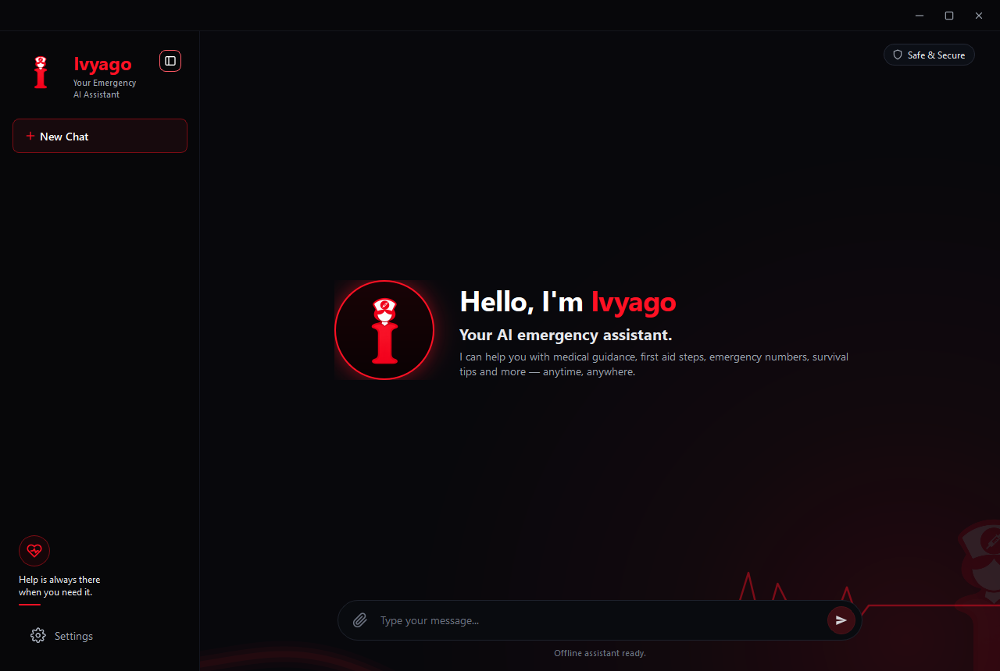
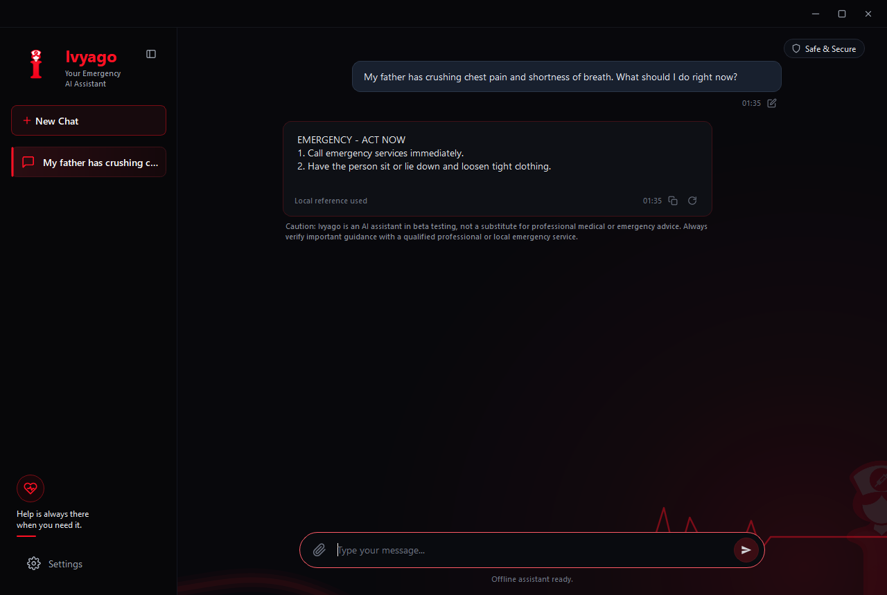
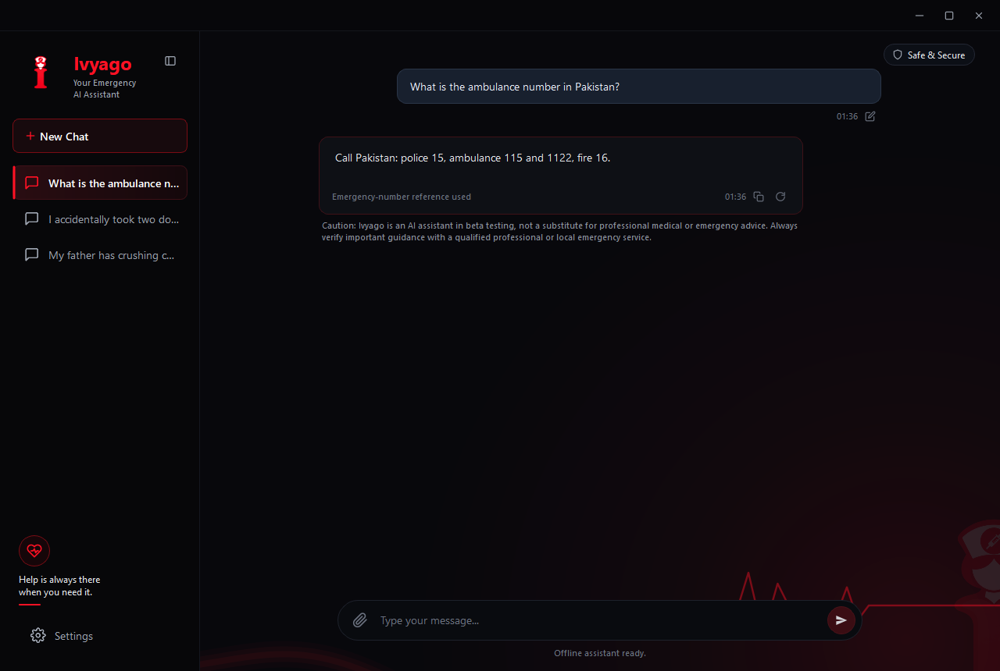
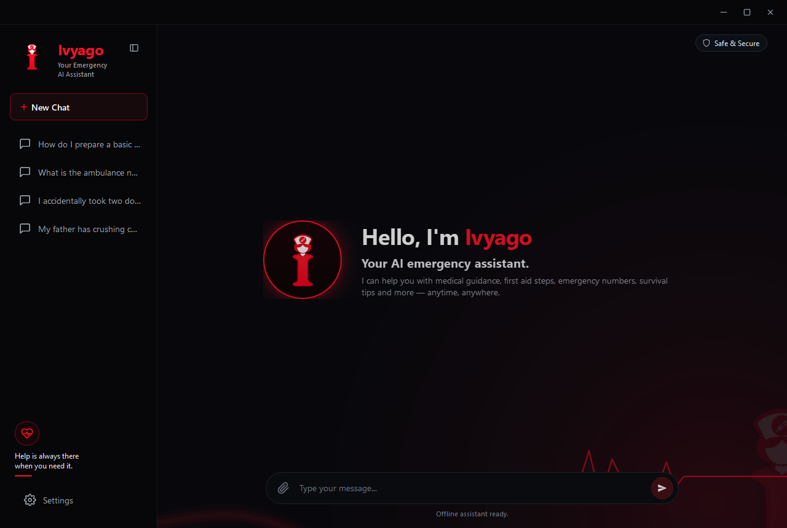

<p align="center">
  
</p>

<p align="center">
  <strong>Offline emergency and safety guidance for Windows.</strong><br>
  Private by design. Ready when the network isn't.
</p>

<p align="center">
  <a href="dist/Ivyago-Setup-0.1.0.exe"><strong>Download Ivyago 0.1.0 for Windows</strong></a><br>
  <sub>44 MB · Windows 10 / 11 (64-bit) · No account required</sub>
</p>

<p align="center">
  <sub>Version 0.1.0 Beta · <a href="#why-ivyago">Why Ivyago</a> · <a href="#screenshots">Screenshots</a> · <a href="#install">Install</a> · <a href="#privacy">Privacy</a> · <a href="#safety">Safety</a> · <a href="#faq">FAQ</a></sub>
</p>

---

Ivyago is a desktop assistant for the moments when you need clear, practical safety guidance and cannot rely on a connection or a cloud service. It runs a compact language model locally on your PC and combines it with bundled first-aid, medicine-safety, and emergency-number references.

No account. No cloud processing. No telemetry. After the one-time model download, Ivyago works completely offline.

## Why Ivyago

Emergency information is usually scattered across search results, apps, and pages written for clinicians. The moments when it matters most are often the worst times to depend on a stable connection, a fast search, or a service that wants your data.

Ivyago was built around three rules:

- **The answer should still work offline.** After setup, every response is generated on your computer.
- **The conversation should stay yours.** Chats live in memory only and disappear when the app closes.
- **Safety beats fluency.** Critical emergencies are grounded in local reference data, unsafe drafts are blocked, and every completed answer carries a beta caution.

## Screenshots

### The home screen



### Emergency guidance

Critical symptoms are answered with immediate, numbered actions and a local reference.



### Emergency numbers

Emergency-number answers are grounded in the packaged country reference instead of being guessed by the model.



### Session chats

Each conversation is a separate in-memory session. Starting a new chat keeps the previous ones available until Ivyago closes.



<sub>Screenshots use example prompts on a local test machine. Answers vary with wording and hardware. The examples are illustrative and are not medical advice.</sub>

## What it does

- **Emergency first aid** — critical symptoms produce immediate, ordered actions and a clear source note.
- **Medicine safety** — questions about doses, pregnancy, interactions, and accidental double doses.
- **Emergency numbers** — verified local numbers where the bundled reference data covers the country.
- **General preparedness** — first-aid kits, travel safety, and everyday safety questions.
- **Streaming answers with Stop** — text appears as it is generated and can be stopped at any time.
- **In-memory sessions** — start, switch, retry, edit, copy, and clear chats without creating a history file.
- **Desktop-first interface** — keyboard focus, accessible controls, selectable text, a low-glare dark theme, and a resizable window.

## Privacy

- **No account and no sign-in.**
- **No ads, analytics, telemetry, or crash reporting.**
- **No cloud model.** The language model and safety references run on your computer.
- **No conversation history.** Chats are kept in RAM only; closing Ivyago discards them. No JSON, SQLite history, cache, export, or backup is written.
- **No background network activity.** The only request is the one-time model download you approve during first-run setup. Opening the repository link from Settings is an explicit action that uses your browser.

The model download requests only the model file from its official source. Messages, prompts, symptoms, and reference lookups are never sent anywhere.

## Install

1. Download **[Ivyago-Setup-0.1.0.exe](dist/Ivyago-Setup-0.1.0.exe)** (44 MB). Future versions are published under [Releases](../../releases).
2. Run the installer. It installs for your Windows account only, needs no administrator rights, and creates Start Menu and optional Desktop shortcuts.
3. On first launch, Ivyago offers to download its local language model (about 1.1 GB). The download can be paused and resumed, and the file is verified with SHA-256 before it is used.
4. After setup, Ivyago runs offline.

### Windows SmartScreen

The beta installer is **not code-signed yet**, so Windows may show **"Windows protected your PC"** or an unknown-publisher warning. Choose **More info → Run anyway** only if you downloaded the file from this repository. Verify the checksum below if you want to be certain the file is intact.

### Installer checksum

```
SHA-256  9A5CA08A8AEB560E68821BA260C5552ACA5F3EFAE13103C1C9D325C4EC92C6F2
File     Ivyago-Setup-0.1.0.exe
```

On Windows you can verify it with:

```powershell
Get-FileHash .\Ivyago-Setup-0.1.0.exe -Algorithm SHA256
```

### Requirements

| | |
| --- | --- |
| Operating system | Windows 10 or Windows 11, 64-bit |
| Memory | 4 GB minimum, 8 GB recommended |
| Free storage | About 1.3 GB after setup |
| Network | Only for the first-run model download |
| GPU | Not required; the model runs on the CPU |
| Python | Not required |

## How it works

Ivyago combines three local layers:

1. A keyword detector routes each message to general, body/emergency, medicine, or emergency-number handling.
2. Verified reference rows from the bundled SQLite databases are selected for the question.
3. A compact instruction-tuned language model writes the answer. A response policy cleans the text, detects prompt echoes and unsafe medicine guidance, protects critical safety answers, and falls back to a grounded local reference when generated text is not usable.

Everything in that pipeline stays on the machine. There is no cloud fallback and no online provider.

## Safety

> **Caution: Ivyago is an AI assistant in beta testing, not a substitute for professional medical or emergency advice. Always verify important guidance with a qualified professional or local emergency service.**

Ivyago is not a medical device and has not been reviewed or approved by a medical authority. In a life-threatening situation, call your local emergency number first. Do not delay care in order to use this app.

Every completed answer includes the caution above. A stopped response is left unfinished, is not given a source label, and is not presented as final guidance.

## FAQ

**Do I need Python or any other software?**  
No. The installer includes its own runtime, Qt libraries, and local model runner.

**Does Ivyago work offline?**  
Yes, after the one-time model download. Normal use makes no network requests.

**Where are my chats stored?**  
In memory only. There is no history file, database, cache, or export. Closing the app removes every conversation.

**Can I use it without downloading the 1.1 GB model?**  
Not currently. The local model is required to generate answers.

**Why does Windows warn about the installer?**  
The beta build is not code-signed. Verify the SHA-256 and only run downloads from this repository.

**How do I uninstall Ivyago?**  
Open **Settings → Apps → Installed apps → Ivyago → Uninstall**. Uninstalling also removes the downloaded model.

**Does Ivyago replace emergency services?**  
No. Call your local emergency number first, then use Ivyago for supporting information if it is safe to do so.

## License

Ivyago is distributed under the **Apache License 2.0**. See [LICENSE](LICENSE) for the full text. Third-party notices and the LGPL license for Qt are installed with the app.

The public download is distributed as a compiled Windows application.

---

<p align="center">
  <sub>Built for the moments that matter. · Ivyago 0.1.0 Beta</sub>
</p>
